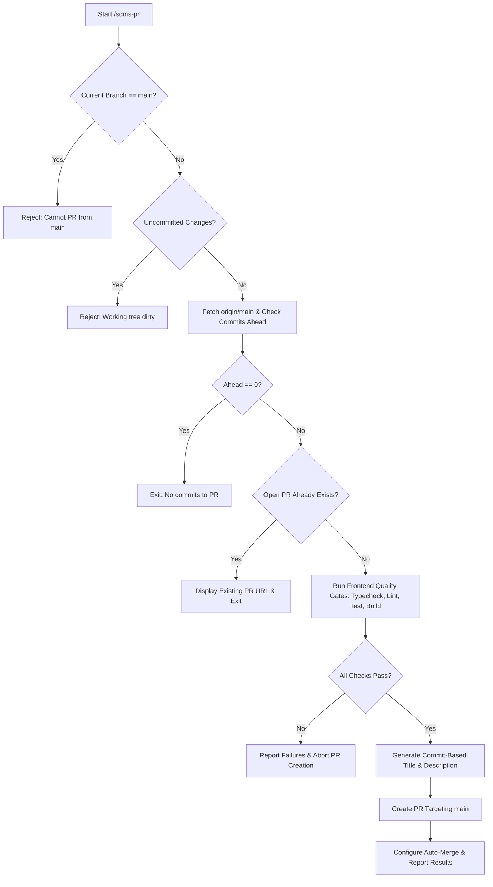

# SCMS Pull Request Automation Skill (`/scms-pr`)

Automates the complete pre-PR verification, metadata derivation, and pull request creation lifecycle for the **Smart Complaint Management System (SCMS)** repository targeting the default branch `main`.

---

## Workflow Overview

When triggered via `/scms-pr` or by asking to create/automate a pull request, the agent follows these sequential steps:



---

## Step-by-Step Instructions

### Step 1: Identify Branch & Enforce Branch Safeguards

Execute:
```bash
git branch --show-current
```

- **Safeguard (SCMS-PR-01):** If the branch is `main`, immediately abort:
  > `Error: Cannot create a pull request from the default branch 'main'. Please switch to or create a feature branch first (e.g., git checkout -b feature/<task-name>).`

### Step 2: Check for Working Tree Cleanliness

Execute:
```bash
git status --porcelain
```

- **Safeguard (SCMS-PR-02):** If there are uncommitted changes (staged or unstaged), abort:
  > `Error: Working tree has uncommitted changes. Please commit or stash all changes before creating a pull request.`

### Step 3: Fetch Remote & Inspect Commit Divergence

Execute:
```bash
git fetch origin main
git rev-list --left-right --count origin/main...HEAD
```

- Output format: `<behind>\t<ahead>`
- If `<behind> > 0`: Advise merging `origin/main` into the feature branch first to resolve potential merge conflicts.
- If `<ahead> == 0`: Abort:
  > `Notice: Current branch has 0 commits ahead of origin/main. Nothing to pull request.`

### Step 4: Check for Existing Open Pull Requests

Check if an open pull request already exists for this branch targeting `main`:

```bash
gh pr list --head "$(git branch --show-current)" --base main --state open --json number,title,url
```

*Or via GitHub REST API if `gh` CLI is not installed:*
```bash
node -e "fetch('https://api.github.com/repos/Smart-Complaint-Management/Smart-Complaint-Management-System-SE-Project/pulls?head=Smart-Complaint-Management:' + process.env.BRANCH + '&base=main&state=open', { headers: { 'User-Agent': 'Antigravity-Agent' } }).then(r=>r.json()).then(prs => console.log(prs.length ? 'EXISTS: ' + prs[0].html_url : 'NONE'))"
```

- **Safeguard (SCMS-PR-03 - No Duplicates):** If an open PR already exists, display the PR number and URL, and stop without creating a duplicate.

### Step 5: Run Frontend Quality Gates

Before opening the PR, run all required frontend verification commands from the `frontend/` directory:

1. **Typecheck:**
   ```bash
   npm run typecheck
   ```
2. **Linting:**
   ```bash
   npm run lint
   ```
3. **Unit & Integration Tests:**
   ```bash
   npm test
   ```
4. **Production Build:**
   ```bash
   npm run build
   ```

- If any of these commands fail, stop immediately, report the failure with error logs, and do not open the pull request until fixed.

### Step 6: Generate Meaningful PR Title & Description

Derive title and body from the actual commits on the branch ahead of `origin/main`:

```bash
git log origin/main..HEAD --oneline
```

- **Title Format:** Use the conventional commit title of the top commit (e.g., `feat: ...`, `fix: ...`, `refactor: ...`), or a concise summary if multiple commits are present.
- **Description Format:**
  ```markdown
  ## Pull Request Overview
  
  [Summary of feature / bug fix / changes implemented]
  
  ### Included Commits
  - <hash>: <commit subject>
  
  ### Verification & Quality Gates
  - [x] TypeScript typecheck passed (`npm run typecheck`)
  - [x] ESLint passed without errors (`npm run lint`)
  - [x] Vitest test suites passed (`npm test`)
  - [x] Production bundle built successfully (`npm run build`)
  
  ### Merge Safeguards
  - Direct pushes to \`main\` are prohibited.
  - Requires code review approval and passing CI status checks prior to merge.
  ```

### Step 7: Create Pull Request Targeting `main`

Execute:
```bash
gh pr create \
  --base main \
  --head "$(git branch --show-current)" \
  --title "<generated-title>" \
  --body "<generated-body>"
```

*If `gh` CLI is not installed, prompt the user with the direct compare URL:*
`https://github.com/Smart-Complaint-Management/Smart-Complaint-Management-System-SE-Project/compare/main...<branch>?expand=1`

### Step 8: Configure Auto-Merge Safeguards

If repository settings permit GitHub auto-merge:
```bash
gh pr merge --auto --squash
```

- **Safeguard (SCMS-PR-04):** Auto-merge will NOT bypass reviews or CI checks; GitHub executes the merge only after all required approvals and CI checks are satisfied.

### Step 9: Display Results & Next Steps

Provide the user with:
1. Active branch name and target branch (`main`).
2. Pull Request URL and number.
3. Quality gate verification summary table.
4. CI status check information.
